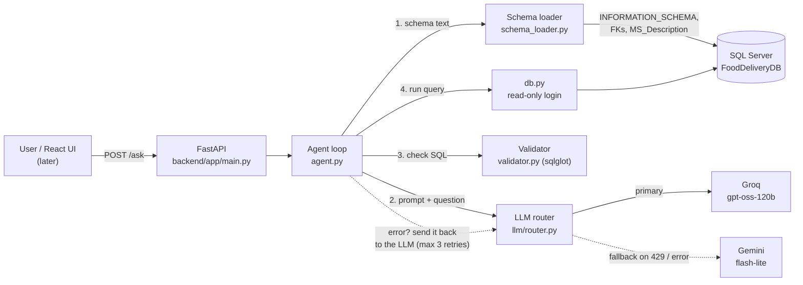

# SQL Agent: plain-English questions for a food delivery database

City managers, operations, marketing and restaurant-partnership teams at a food delivery platform (like Swiggy or Zomato) need answers from data all day. They don't write SQL, so today they wait hours or days for the data team.

This **SQL Agent** turns a plain-English question into **T-SQL** and runs it on **Microsoft SQL Server**. It returns the results together with the generated SQL, so every answer can be checked.

> "Which restaurants have the highest cancellation rate, and what's their food rating?"
> → SQL + result table + chart suggestion + a step-by-step trace of how the agent got there.

The agent is built **from scratch, with no LangChain, LlamaIndex or other agent framework**, so every step is visible in a handful of small, commented Python files. The core loop is in [agent.py](backend/app/agent.py). The guide [docs/HOW_IT_WORKS.md](docs/HOW_IT_WORKS.md) walks through each step.

---

## Architecture



**Three layers of guardrails (defence in depth):**

| # | Guardrail | Where | Stops |
|---|-----------|-------|-------|
| 1 | Prompt rules | [prompts.py](backend/app/prompts.py) | Most bad SQL before it's written |
| 2 | sqlglot validator | [validator.py](backend/app/validator.py) | Anything that isn't a single read-only `SELECT`, and adds `TOP 200` |
| 3 | Read-only SQL login | [04_create_readonly_user.sql](database/04_create_readonly_user.sql) | Any write, even if layers 1 and 2 fail |

---

## Project structure

```
SQLAgent/
├── database/              SQL scripts to run in SSMS (create DB, tables, descriptions, read-only user, checks)
├── data_generator/        Reproducible sample data with planted business patterns
│   └── PLANTED_INSIGHTS.md   which patterns exist and which questions reveal them
├── backend/
│   ├── app/               config, db, schema_loader, llm/, prompts, validator, agent, chart, cli, main (API)
│   └── tests/             pytest: validator, agent loop, charts, end-to-end
├── scripts/run_demo_questions.py   dress rehearsal for the demo -> demo_results.md
├── docs/HOW_IT_WORKS.md   beginner-friendly walkthrough of the agent
├── .env.example           every setting, documented
└── requirements.txt       pinned Python packages
```

---

## Setup from zero (Windows)

### 1. SQL Server and SSMS
1. Install **SQL Server 2019 or later**. The free Express or Developer edition is fine. Also install **SQL Server Management Studio (SSMS)**.
2. **Turn on mixed-mode authentication.** The agent logs in with a SQL login, not your Windows account.
   1. In SSMS, right-click the server and choose **Properties**.
   2. Go to **Security** and select **SQL Server and Windows Authentication mode**.
   3. Right-click the server again and choose **Restart**. The setting only takes effect after a restart.

### 2. ODBC Driver 18
Install **Microsoft ODBC Driver 18 for SQL Server** (search for "Download ODBC Driver for SQL Server"). Check that it's installed:
```powershell
Get-OdbcDriver -Name "ODBC Driver 18*"
```

### 3. Create the database (SSMS)
Open each script in SSMS and press **F5**, in this order. [database/README.md](database/README.md) explains how to verify each step.
1. `database/01_create_database.sql`
2. `database/02_create_tables.sql`
3. `database/03_add_descriptions.sql`
4. `database/04_create_readonly_user.sql`. First replace `<<REPLACE_WITH_STRONG_PASSWORD>>` with a password of your own. Don't commit the real password.

### 4. Python environment
You need **Python 3.11 or later**. From the repository root:
```powershell
python -m venv venv
.\venv\Scripts\Activate.ps1          # if blocked: Set-ExecutionPolicy -Scope CurrentUser RemoteSigned
pip install -r requirements.txt
```

### 5. Configure `.env`
```powershell
Copy-Item .env.example .env
```
Fill in these three values (everything else has sensible defaults):

| Setting | Value |
|---|---|
| `DB_READONLY_PASSWORD` | The password from step 3.4 (watch out for trailing spaces) |
| `GROQ_API_KEY` | Free key from https://console.groq.com/keys |
| `GEMINI_API_KEY` | Free key from https://aistudio.google.com/apikey |

If your server is a named instance (common with Express), also set `DB_SERVER=localhost\SQLEXPRESS`.

### 6. Load the sample data (about 1 minute)
```powershell
python data_generator\seed_data.py
```
This creates about 80,000 orders. The data is the same every time you run it on the same day. To sanity-check it, run `database/05_verify_data.sql` in SSMS.

### 7. Run the API
```powershell
cd backend
uvicorn app.main:app --reload
```
Open **http://localhost:8000/docs**, choose `POST /ask` → **Try it out**, and ask a question.

---

## Everyday commands

All of these run from `backend/` with the venv active, except the last one.

| What | Command |
|---|---|
| Ask from the terminal | `python -m app.cli "Top 5 most ordered dishes in Hyderabad"` |
| See the schema the LLM receives | `python -m app.cli --show-schema` |
| Get the full JSON result | `python -m app.cli "..." --json` |
| Run the fast tests (no LLM needed) | `pytest -m "not e2e"` |
| Run all tests (uses LLM quota) | `pytest` |
| Run the demo rehearsal (from the repo root) | `python scripts\run_demo_questions.py` → `demo_results.md` |

### API endpoints

| Method | Path | Purpose |
|---|---|---|
| GET | `/health` | API status, database connectivity, active LLM provider |
| GET | `/schema` | Tables, columns, descriptions and relationships (for the UI) |
| POST | `/schema/refresh` | Reload the schema cache after changing the database |
| POST | `/ask` | `{"question": "..."}` → `sql`, `explanation`, `columns`, `rows`, `chart`, `trace`, `error`, ... |
| GET | `/examples` | 22 curated demo questions, grouped by persona and by SQL concept |

CORS is enabled for `http://localhost:5173` (Vite) and `http://localhost:3000` (React).

---

## Troubleshooting

### "Data source name not found and no default driver specified" / `IM002`
ODBC Driver 18 isn't installed, or `DB_DRIVER` in `.env` doesn't match the driver's name exactly.
- To list the installed drivers, run `python -c "import pyodbc; print(pyodbc.drivers())"`.
- Put the exact name in `.env`, e.g. `DB_DRIVER=ODBC Driver 18 for SQL Server`.
- If you only have Driver 17, you can use that name instead.

### "Login failed for user 'sql_agent_reader'" (`28000`, error 18456)
Work through these in order:
1. **Mixed-mode authentication is off, or the server wasn't restarted after you turned it on.** See setup step 1. To check, run `SELECT SERVERPROPERTY('IsIntegratedSecurityOnly')` in SSMS. It must return **0**.
2. **The password in `.env` doesn't match** the one in script 04. A trailing space is a common cause.
3. **The login doesn't exist yet.** Re-run `04_create_readonly_user.sql`.
4. **The login is locked after too many wrong passwords.** Run `ALTER LOGIN sql_agent_reader WITH PASSWORD = '...' UNLOCK` as an admin.

### SSL / certificate errors ("The certificate chain was issued by an authority that is not trusted")
Driver 18 encrypts connections by default, and a local SQL Server uses a self-signed certificate. Keep `DB_TRUST_SERVER_CERTIFICATE=yes` in `.env`. In SSMS, tick **Trust server certificate** on the login screen. In production, use a real certificate and set this to `no`.

### "Cannot open server" / "server was not found" / timeout on connect
- Check that the server name matches what you type in SSMS: `localhost`, `localhost\SQLEXPRESS` or `.\SQLEXPRESS`.
- Check that the **SQL Server** service is running in *Services* or *SQL Server Configuration Manager*.

### 429 rate limits, or "All LLM providers failed"
Both providers are on free tiers:
- **Groq** allows about **8,000 tokens per minute**. Each question sends about 3,600 tokens, so that's roughly **2 questions per minute**. The router then automatically falls back to Gemini, or waits for Groq if Groq says "try again in N seconds" (up to 20 s). You'll see this as `llm_fallback` / `rate_limit_wait` steps in the trace.
- **Gemini** sometimes returns **503 "high demand"** on its bigger models. `gemini-3.5-flash-lite` was the most reliable in testing, which is why it's the default.

**During a demo:** leave about 20–30 seconds between questions. To make Gemini the primary provider instead, set `LLM_PROVIDER=gemini`.

### "Rate limit" errors from Gemini mentioning `retryDelay`
You've reached Gemini's requests-per-minute or requests-per-day limit. Wait a minute, or switch `GEMINI_MODEL` to another free Flash model listed in `.env.example`.

### The agent's answer looks wrong
LLMs aren't deterministic, so the same question can produce different SQL. To investigate:
1. **Read the SQL.** It's always shown, and that's why it's there.
2. **Check the trace** for retries.
3. **Rephrase the question to be more specific**, e.g. "delivered orders only", "minimum 100 orders".

Before a demo, run `python scripts\run_demo_questions.py` and check `demo_results.md`.

---

## Security notes
- **Secrets live only in `.env`**, which is git-ignored. Never commit it.
- **The agent never uses an admin connection.** Only `data_generator/seed_data.py` does, for seeding.
- **The API never returns stack traces.** Errors are logged server-side and the client gets a generic message.
- **The validator and the read-only login are independent.** Each one alone blocks writes.
